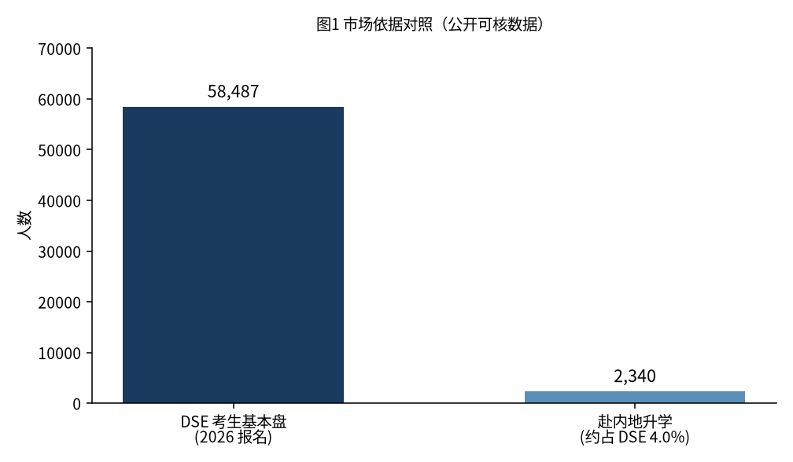
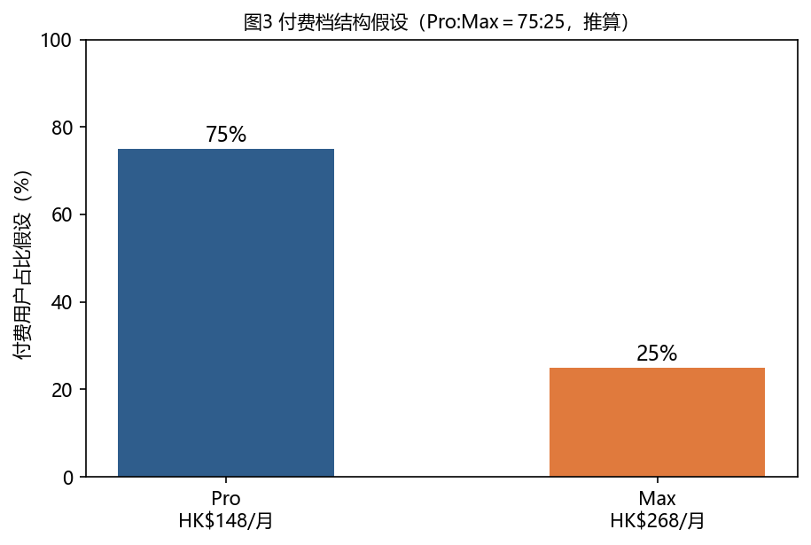
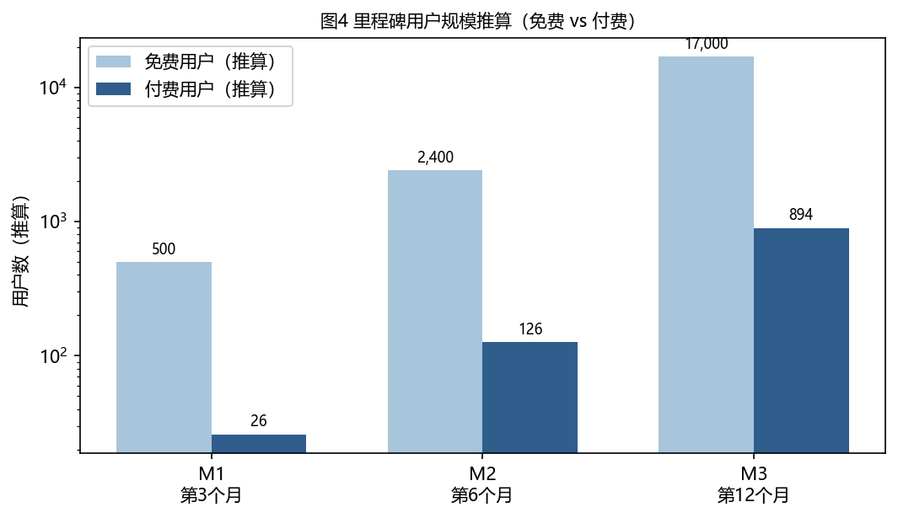
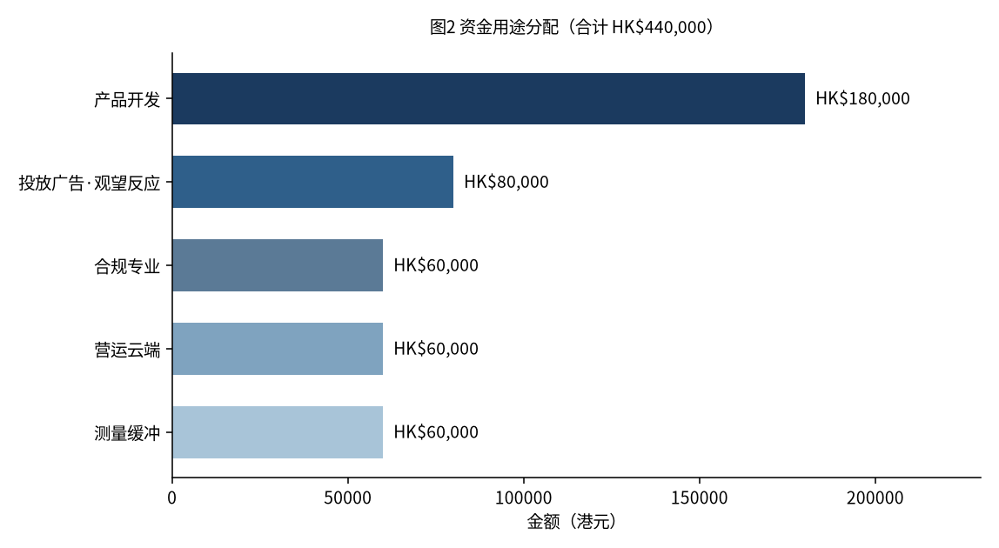

# Veridex 书面计划书

| 项目 | 内容 |
|---|---|
| 项目 | Veridex 维学 |
| 发文者 | 黄浩然、黄羿捷／浩然组 |
| 受文者 | 青年创业基金委员会 |
| 课程 | CLC3242P 书面计划书 |

---

## 目录

1. [内容提要](#1-内容提要)
2. [公司介绍](#2-公司介绍)
3. [问题与机会](#3-问题与机会)
4. [产品和服务](#4-产品和服务)
5. [市场分析](#5-市场分析)
6. [商业模式与定价](#6-商业模式与定价)
7. [营销计划](#7-营销计划)
8. [交付与运营](#8-交付与运营)
9. [财务计划](#9-财务计划)
10. [风险与应对](#10-风险与应对)

---

## 1. 内容提要

### 给学生看的一天

早上七点，阿明对着昨晚的数学卷。三道题只有红叉，没有人告诉他到底卡在哪一步。他把题目贴进免费聊天工具，对方很快给出解法；他抄完，心里仍虚——下次数字一换，还会不会？

下午自修，他想按自己那本薄讲义重学「排列」。聊天工具每次都要从头交代：「我在读中五、我用的是这份讲义、我昨晚错在有重复／无重复。」讲完一题，没有人当场出三道类似的题让他过关；过了两天，也没有人记得再问他一次。

晚上九点，他真正需要的其实很具体：有人按他的讲义排一节十五分钟的课；讲完当场出题，告诉他过关还是没过关；若没过关，只补真正不会的那一层；后天再问一次。现在市面上很少有人把这几步接成一条，还跨天接着教。

### 我们做什么

Veridex 维学是面向学生的课程学习应用。我们按学习者上传的讲义或口述需求生成专属课程，以每节 10–15 分钟讲解并当场验收，并在下一次课从学习者卡住的地方继续教学。我们要学生按自己的讲义把一节课学完并过关——加速学习，同时守住学习质量。

我们提供四项核心服务：课程生成、课堂上课、课程共享，以及**就这一节的随堂提问／随时问正在学的内容**（课中可问，课后也可就该节内容提问）。检测、错题追溯与间隔重复等机制支撑上述服务。我们先从香港公开试（DSE）场景起步，以可逐年核对的考生人数为市场基本盘。

本项目由黄浩然、黄羿捷两人合伙推进，据点设在香港，目前无分支机构。我们处于设计与启动阶段，原型尚未完成，尚无真实用户。商业模式为个人订阅制（Free／Pro／Max）。我们申请 **HK$440,000**，覆盖 18 个月。本轮希望用这笔资金完成三件可核验交付：可试用产品、小额广告试验的实测成本区间，以及第一批可核验的激活、付费与续订数据。营收规模（含约 894 付费用户、年经常性收入约 HK$182 万等数字）一律列为**推算观测情景**，**不作为本轮验收承诺**。凡未经账单核实的财务数字，一律标明 **推算**。

我们寻找资助，是为了把设计做成可试用的产品，并取得第一批真实课堂与付费数据。

---

## 2. 公司介绍

Veridex 维学由黄浩然、黄羿捷两人合伙推进。企业据点设在香港，目前无分支机构；团队以香港为协作中心，产品分发优先采用网页。我们尚未完成公司注册与商业登记；合规与专业服务预算 HK$60,000 包含此项安排。

**我们计划做什么。** 我们开发和运营一门课程学习应用：按个人需求生成专属课、按程度验收、支援课程共享，并提供就这一节的随堂提问（课中与课后均可就正在学的内容提问）。商业模式是**用户个人订阅制**——Free 为体验入口，Pro（HK$148／月）为主力付费档，Max（HK$268／月）为重度使用者出口。主收入路径是 Pro 与 Max。

**价值观。** 我们要学生按自己的讲义把一节课学完并过关：加速学习，同时保证学习质量。学习之外的事务（找课、备题、跟进度）可以由系统承担；学习之内——包括自己动手做题——我们不代劳。

**短长期目标。** 短期（18 个月）：交付可试用产品，完成第一版广告试验，并取得激活、付费与首次续订的可核验数据。长期（一至五年）：在香港学生场景跑通后，再承接大学复习、在职进修及赴内地升学等路径。学校与机构采购（例如「智启学教」）属日后可选路径，**本轮不计入个人订阅推算与增长模型**。

**组织与招聘。** 目前员工为两人。两人都能参与产品与工程，也能向学生清楚说明产品价值。本轮申请期内以两人交付为主；**待产品上线并出现稳定付费后，再考虑招聘第 3 人**（优先工程或运营）。更大规模招聘不列入本申请承诺。

**领导分工。** 黄浩然负责产品与学习体验（含内容抽检主责）；黄羿捷负责商业与增长（含宣传试验、合规与事故升级）。路演分工与日常职责一致。

---

## 3. 问题与机会

### 课对所有人是同一份

老师的注意力是有限的：一份讲义、一条进度，往往只能按「一个人」来排。结果是学得快的被拖慢，学得慢的掉队；学生真正想学的起点，课堂常常对不上。定制的瓶颈在注意力的边际成本——为每人排一份进度，传统课堂做不起。学生已经把通用对话工具当作老师使用；仍然缺少的，是按个人需求长出来的课，以及跟得上个人反应的进度。

### 学完之后，很难知道自己到底会不会

学会一件事，通常要先明确起点、观看示范、自己动手，再加以整合；后两步必须亲自完成，动手之前没有人知道你会了多少。学生很少主动做检验；自己判断「会了」时，又容易估得不准——觉得会了，一考才发现不会。

一题做错了，真正要回答的是四件事：挂在哪个知识点、为什么错、补哪一块、多久再问一次。多数产品主要碰到第一层。我们核对公开产品后发现，检验功能并不稀缺；稀缺的是把这四步问清楚，并接到下一节课继续教——跨堂接着补洞。

### 我们从哪开始

同一套机制可以服务很广的学习需求，换的是上传的档案或说出的需求。我们先从香港学生、香港公开试这个有明确期限、可逐年核对人数的场景做起（市场数字见第 5 章）。内地高考报名约 1,290 万仅作品类量级参照，不作我们的分母。首发落在香港学生，再承接赴内地升学等正在变动的路径。

---

## 4. 产品和服务

### 我们卖什么

Veridex 维学是为学习而生的课程学习应用。学生打开后能做的事很具体：按自己的讲义或一句话需求，生成一门专属课；每节 10–15 分钟讲完当场验收；跨堂从上次卡住的地方接着教。

产品包含四项核心功能：

1. **课程的生成**：按资料或一句话需求，生成专属课程（章节 → 知识点 → 每节 10–15 分钟，自带检测）。
2. **课堂上课**：语音讲解、板书同步，可打断、追问、换讲法；文字、图片与动画同屏呈现。
3. **课程的共享**：使用者之间共享课程，把已生成并跑通过的课传给同学或后来的学习者。
4. **就这一节的随堂提问／随时问正在学的内容**：上课过程中可以提问，课后也可以随时就该节内容提问；帮助即时澄清疑惑，而不另开无关闲聊。

检测、错题追溯与间隔重复等是支撑机制。我们对外强调三句价值：跨堂记住卡点；错题只补真正不会的那一层；学习之外的事交给系统，学习之内不代劳。

### Web 与 App

Web 与 App 的界面与功能保持一致，仅按屏幕尺寸做视窗适配；两端共用帐户、每日可用额度与课程进度。结帐优先通过网页完成。界面布局细节不在此展开；原型图将另行附上，供委员会对照参考。

### 用户怎么用（一节课为单位）

循环单位是一节课：**10–15 分钟语音教学**。一节课有明确的完成状态——学完检测，就知道这节有没有白听。

典型路径：提出需求（上传或口述）→ 澄清与生成 → 上课（语音与板书）→ 追问或换讲法 → 检测过关 → 追溯补洞 → 间隔重复 → 共享与回看（复看不扣当日可用节数）。跨堂记住上次卡在哪，下一节从那里接着教。

### 讲解与答问如何配置

| 场景 | 我们的做法 | 学生看到的结果 |
|---|---|---|
| 课程生成 | 出整门课时选用较稳的生成服务 | 课的结构更完整 |
| 就这一节的随堂提问／追问 | 简单问题走较省的讲解／答问服务；疑难走较强服务 | 月费与「一天能上几节」保持稳定，成本由我们控制 |

语音主路径：系统先写好要讲的内容，再转成语音播出。学生只需记住「一天能上几节课」；同样额度背后，我们可按难度选用不同成本的服务路径，月费保持稳定。

---

## 5. 市场分析

### 目标市场

我们先从香港学生、香港公开试做起。公开试有明确期限，人数可逐年核对。市场基本盘采用 DSE 考生人数；旁边列出赴内地升学人数，说明这条路径正在变动。

| 市场依据 | 数字 | 说明 |
|---|---|---|
| DSE 考生基本盘 | 58,487（2026 年报名，约 97% 应考） | 考评局公开数据 |
| 赴内地升学 | 2,340 人（约占 DSE 考生 4.0%） | 立法会答覆 2024-11-13 |
| 品类量级（背景） | 内地高考报名约 1,290 万 | 仅作参照，不作我们的分母 |

*图1 市场依据对照：DSE 考生基本盘与赴内地升学人数（公开可核数据）。*

首批对象是准备香港公开试的中学生——按讲义或错题出专属课，10–15 分钟一节验收。决策看「这节有没有白听」，以及「错了能不能补到真正不会的那一层」。本轮不以「香港补习市场总规模」金额作为依据。同一套机制也可服务大学复习与在职进修；首发仍落在香港学生。

### 为什么选择付费订阅，而不是继续使用免费聊天工具

委员会关心的是一句清楚的话：**学生为什么不继续使用免费聊天工具，却要每月支付 Pro 的 HK$148？**

免费聊天工具很擅长「答一题」。学生贴上题目，很快得到解法或讲解。缺少的是把学习接成一条可重复的流程：

| 学生可感知的差别 | 免费聊天工具（典型用法） | Veridex（产品设计） |
|---|---|---|
| 按我的讲义出一整门课 | 每次要自己重新交代背景 | 上传或一句话需求 → 生成带章节的专属课 |
| 15 分钟一节，讲完就知道有没有白听 | 很少有「本节过关／不过关」 | 每节自带检测，有完成态 |
| 错了只补真正不会的那一层 | 多半重讲整题或给标准答案 | 追到挂点、原因、补哪、何时再测，并接到下一节 |
| 隔天还记得我卡在哪 | 新对话常从零开始 | 跨堂接着教 |
| 把跑通的课传给同学 | 难整理成可共享的课 | 课程共享是四核之一 |

上述差别目前来自产品结构设计，**尚无真实学生试用证据**。本轮 HK$440,000 要取得的，正是把结构做成可点开的产品，并用第一批课堂记录核验学生是否感知到上述差别（见第 9 章三条验收）。

价位方面：Pro HK$148 贴近本地可查的教育订阅量级（公开可核的同区教育订阅约 HK$156／HK$158 一带）；Max HK$268 作为重度出口。价位 **0／148／268** 本轮不改。

### 竞争分析

形态上最接近我们的是 Hyperknow：从零生成课程、带测验、按订阅额度计费。据媒体报道，它刚获得真格基金约 **US$1M（约 HK$780 万）种子轮**——大约是我们本轮申请 **HK$440,000** 的近二十倍。对手已有机构资金，我们仍是两人启动；我们不在同一起跑线上比较速度。公开可核的结构差异包括：对方目前没有手机 App；其私隐政策写明用户不应上传受专业特权保护的资料。我们把月费做成「一天能上几节课」的稳定价目。两边额度单位定义不同，本计划书不作数字并排换算。

| 玩家 | 可核对的状态 |
|---|---|
| Hyperknow | 种子轮量级；形态最接近；无手机 App |
| Coursera 语音对话 | 有语音路径，但不支援中文，对香港学生门槛高 |
| DeepLearning.AI | 未见语音即时教学这条线 |
| LearnVector（Coursera 投资约 US$1 亿） | 官方披露项目仍在开发中 |

我们核对公开产品后发现，检验功能并不稀缺。差别写在结构上：错题要答完「挂点／原因／补哪／何时再测」四步，并接到下一节继续教；同时交付手机 App。品类仍早（最像的一家仍在种子轮）。内容策略偏「薄」——课从用户资料生成，不靠自建海量题库。我们尚无真实用户；本轮不与对手比用户规模，只比能否在 90 天内交出可核验的课堂记录。

### SWOT 分析

| | 有利 | 不利 |
|---|---|---|
| **内部** | **优势（S）**：四项核心绑验收；月费对应「一天几节」价目稳定；Web／App 界面与功能一致；两人兼产品与工程，自研不外包 | **劣势（W）**：两人、零用户、原型未完成；尚无自有转化与续订数据；品牌远弱于成熟教育产品；对手种子轮量级远高于本轮申请 |
| **外部** | **机会（O）**：品类仍早；DSE 基本盘可逐年核对；学生对「讲完即验收」有清晰决策点 | **威胁（T）**：大厂或相近产品上线；内容偶发讲错与学术诚信尚未用自有数据验证；付费转化若长期低于打平线，免费补贴会压接口成本 |

学校与机构采购窗口本轮不计入增长与收入模型，故不写入机会格。

---

## 6. 商业模式与定价

我们卖的是「学完一节课并通过验收」，计费用个人订阅。免费档是体验入口；Pro 是主力付费档；Max 是重度使用者的出口。

| 档 | 月费（港元） | 对外说明（每天能上几节） | 每日额度（内部计量） |
|---|---|---|---|
| Free | HK$0 | 每天约 2 节短讲解 | 60 |
| Pro | HK$148 | 每天约 5 节完整课 | 375 |
| Max | HK$268 | 每天约 10 节完整课 | 750 |

*图3 付费档结构：左为三档月费；右为付费内 Pro:Max＝75:25 内部假设（推算）。*

用户主要记住「一天能上几节课」；月费保持稳定。新生成扣当日可用额度，回看不扣。主收入是 Pro／Max。分发优先通过网页上的 **Stripe** 收款——Stripe 是国际常用的线上收款服务，我们接入后，学生可用信用卡等常见方式支付订阅费用。

---

## 7. 营销计划

### 定位与品牌信息

**定位陈述。** 我们面向准备香港公开试的学生：按资料生成课程、按程度验收，10–15 分钟一节，跨堂补洞。相对通用对话工具，验收与跨堂进度写进产品结构；相对最接近的生成课形态，我们同时交付手机 App，并把月费对应成「一天能上几节课」的稳定价目。

**品牌信息。** 对外沟通突出三句价值（见第 4 章）与提要中的产品承诺：按讲义出课、当场验收、跨堂接着教。语气亲切而专业，少用技术黑话。

### 获客渠道与策略

本轮计入增长与收入推算的渠道有两条；学校与机构渠道另作补充说明，不写入下表。

| 渠道 | 做法 | 是否计入本轮增长／收入推算 | 观望什么 |
|---|---|---|---|
| **学生口碑／转介绍** | 试用后分享已生成课；邀请同学试用 | **计入**（主路径） | 注册→激活→付费各步人数 |
| **投放广告，观望市场反应** | 社群／搜寻等选定渠道；HK$80,000 小额试验；单日／单周上限预先写明 | **计入**（试验路径；不承诺爆发） | 点击→注册→试用→付费；吸纳客户的成本区间 |

广告用于观望市场反应；主路径仍强调口碑的长期性。我们一边小额投放，一边邀请第一批人真实试用。

**补充说明（不计入本轮模型）：** 学校与机构渠道（例如「智启学教」）属机构采购，周期较长；本轮尚无校端关系。有书面意向后再单列，不与个人订阅推算混写。

### 增长三档（推算；学校渠道已排除）

下列为**推算观测情景**，用于说明敏感度；**本轮验收不绑死任一档的付费人数或年经常性收入。**

**路演与答辩默认表述：保守档付费人数**（第 3 个月约 6–8；第 12 个月约 200）。基准与乐观仅作观测上界，口头叙述不以之为承诺。

| 时点 | **保守（默认口述）** | 基准（观测） | 乐观／冲刺（观测） |
|---|---|---|---|
| 第 3 个月（M1）免费／付费 | 约 200／约 **6–8** | 约 350／约 10–15 | 约 500／约 26 |
| 第 6 个月（M2）免费／付费 | 约 800／约 **30** | 约 1,500／约 60 | 约 2,400／约 126 |
| 第 12 个月（M3）免费／付费 | 约 5,000／约 **200** | 约 10,000／约 450 | 约 17,000／约 894 |
| 第 12 个月年经常性收入（推算） | 约 **HK$40 万**量级 | 约 HK$90 万量级 | 约 HK$182 万 |

第 3 个月约 26 个付费属**乐观观测**，不是默认口述数字。可能来源（均须产品可试用之后才成立）：熟人圈与同学网络的邀请试用、第一档广告试验的少量转化、试用后转介绍。没有产品、没有品牌时，我们不能把 26 写成承诺——**默认讲保守约 6–8**。若首月账单更低，我们改表，不硬撑。

*图4 增长三档付费用户推算（保守／基准／乐观）；学校渠道未计入。均为推算观测项，非本轮验收承诺。*

### 工具与指标目标（推算）

营销与产品侧共用的量度工具：网页分析（流量与注册来源）、Stripe 账单（付费与续订）、应用内事件（激活、听完一节、验收通过）。激活定义为：注册后 24 小时内听完一整节 10–15 分钟课，并通过 1 个知识点验收。

| 指标 | 目标／说明（推算） | 时点 |
|---|---|---|
| 激活率 | 上线后盯注册→激活转化；首月入表 | 第一版可试用起 |
| 付费转化 | 规划基准约 5%（外部走廊约 2.18%–9%）；作观测 | 上线后第一个完整月对照账单 |
| 首次续订 | 拿到可核验续订人数与比例 | 第 6 个月（M2） |
| 吸纳客户的成本 | 由 HK$80,000 广告试验量度实测区间 | 第一批广告档期结束后公布 |
| 试用规模 | 以三档表为观测；验收看「可核验人数入表」 | 第 3 个月起 |

若付费占比连续约八周低于 2% 且免费利用率高于 70%，我们收紧 Free 日语音供给并改表；广告成本高于可接受上限则停投或换渠道。价位 0／148／268 本轮不改。

---

## 8. 交付与运营

本产品为软件订阅服务，无实体库存与货运。本章说明如何把同一套 Web／App 交到学生手上、如何守内容质量，以及事故与团队分工。

### 交付形态

Web 与 App 界面与功能一致，仅视窗适配（见第 4 章）；结帐优先网页 Stripe。宣布可用前须完成冻结抽检（见下）。

### 内容质量与责任

我们承诺的是机制，不承诺「永不出错」：

1. **入口闸**：生成前检查有效意图与可解析目标；坏输入不进生成，并给出可读原因。
2. **生成期三道闸**：出声前知识点须绑定来源（无来源不发声）；检测题二次复算不一致则不进课；学生标错进失败队列，**48 小时内处理**。DSE 课挂公开考纲标签；禁止编造等级预言。
3. **抽检**：宣布可用前冻结抽检至少 20 节（分层含 DSE），致命缺陷为零；上线后**每周分层随机抽检 5 节**；致命缺陷 4 小时内启动处理。
4. **题库**：第一版不以全量权威题库交付；先做 DSE 知识点标签表作抽检锚。禁止宣称「含官方真题库」。
5. **责任**：平台负责闸门、抽检与更正；用户对上传版权自负；我们不替用户保证考试成绩。

### 事故与团队

黄浩然主责内容抽检与产品体验；黄羿捷主责宣传试验、合规与事故升级。致命缺陷 4 小时内启动处理；学生标记错误 48 小时内处理。现状：原型尚未完成，真实用户为零。本轮资金用于把设计做成可用产品，并取得第一批课堂记录。

---

## 9. 财务计划

**申请金额：HK$440,000，覆盖 18 个月。**

**本轮验收＝交付物，不等于营收承诺。** 第 12 个月约 894 付费、年经常性收入约 HK$1,820,000 等，一律降为**推算观测情景**（见第 7 章三档表），用于说明单位经济敏感度；**不作为本次申请的验收承诺。**

**本轮 44 万要买到的三条可核验证据：**

1. **可试用产品**：第 90 天学生能点开的功能清单见下表；宣布可用前冻结抽检通过。
2. **广告试验实测**：HK$80,000 投放结束后，公布吸纳一名付费用户的宣传成本区间（或证明该渠道不划算而停投）。
3. **第一批可核验队列**：激活／付费／首次续订人数按月入表（第 6 个月起有续订样本）；用账单校准今日推算。

### 9.1 产品开发 HK$180,000：两人自研（不外包）

我们由创办人两人完成产品开发，**不安排外包开发预算**。招聘支出不占用本项；待上线并有稳定付费后再考虑第 3 人。

**两人每周投入与分工（第 1–90 天）。** 黄浩然主责产品体验、出课流程与内容抽检，每周投入约 **35–40 小时**；黄羿捷主责工程实现、网页／App 界面与增长试验接入，每周投入约 **35–40 小时**。兼职合计不超过每周 12 小时，且前 90 天不接新的长工期兼职。

**HK$180,000 钱买什么（白话）：** 分清「做出产品所必需的试验用量」与「上线后服务学生的用量」——本项只覆盖前者与工具；上线后按量费用由营运／收入承担，不把营运期用量提前写进开发款。

| 用途 | 金额（推算） | 说明 |
|---|---|---|
| 做出产品所必需的试验用量（出课／语音／答问试跑、抽检样课） | 约 HK$50,000–60,000 | 第 1–90 天按里程碑消耗；按月盯用量，用不满则转入缓冲，不虚耗 |
| 开发工具、软件订阅与必要设备 | 约 HK$50,000–60,000 | 设计与工程工具、测试设备等 |
| 第 90 天后至 18 个月的迭代试验额度 | 约 HK$40,000–50,000 | 修缺陷、加进取项时的试验用量 |
| 预留紧急额度 | 约 HK$20,000–30,000 | 突发接口用量或工具续订 |
| 创办人月薪 | HK$0 | 本项不发创办人月薪 |
| **合计** | **HK$180,000** | |

*图6 产品开发款用途构成：试验用量／工具／迭代／紧急；创办人零薪；不含外包。*

**创办人维生。** 两人生活费不从本项支出，来源为各自既有储蓄（书面估计约可支撑 **6–9 个月**零薪全职；第 4–6 个月若告急，优先再压兼职、不挪动保底清单）。若实际试验用量只用掉一半，余下改列测量与现金流缓冲，仍不算「花掉的开发成果」。

**第 90 天学生能点开什么（验收清单）：** 下表列进取八项；其中 **②③④⑧ 为保底四项**——若进度只能交付一半，**只保证这四项按时可点开**。

| # | 学生可点开／可完成 | 对应四核／机制 | 优先级 |
|---|---|---|---|
| 1 | 网页注册／登入；手机 App 同一套界面与功能（仅视窗适配） | Web／App 一致 | 可延后：Web 先可用 |
| 2 | 上传讲义或一句话说想学什么 → 生成一门带章节的专属课 | 课程的生成 | **保底** |
| 3 | 听一节 10–15 分钟讲解（语音＋同步板书）；可打断、追问、换讲法 | 课堂上课 | **保底** |
| 4 | 做完该节检测，看到过关／未过关 | 支撑：检测 | **保底** |
| 5 | 未过关时看到「挂在哪／补哪」的提示，并能进入下一节接着学 | 支撑：追溯／跨堂 | 可延后 |
| 6 | 课中或课后就该节内容提问（随堂提问／随时问正在学的） | 就这一节的随堂提问 | 可延后 |
| 7 | 把已生成、跑通过的课用链结分享给同学 | 课程的共享 | 可延后 |
| 8 | 宣布「可试用」前：冻结抽检至少 20 节（分层含 DSE），致命缺陷为零 | 质量闸 | **保底** |

**保底四项：** ② 生成专属课 → ③ 听一节讲解 → ④ 检测过关／未过关 → ⑧ 冻结抽检通过后再宣布可试用。

### 9.2 单位经济与成本可持续（推算；网页 Stripe）

| | Free | Pro | Max |
|---|---|---|---|
| 月费 | HK$0 | HK$148 | HK$268 |
| Stripe 手续费 | — | HK$7.38（5.0%） | HK$11.46（4.3%） |
| 净收入 | HK$0 | HK$140.62 | HK$256.54 |
| 讲解／答问按量费用（推算，满用） | HK$6.46 | HK$40.37 | HK$80.73 |
| 贡献毛利（推算） | −HK$6.46 | HK$100.25 | HK$175.81 |
| 毛利率（推算） | — | 71% | 69% |

分发优先网页 Stripe；若走 App Store 15%，Pro 毛利推算约降至 58%。上表毛利率随利用率与服务选用波动，非账单实测。

**成本结构（推算）**：变动成本约 98.8% 是接口费用，云端约 1.2%。档位与每日额度把单人成本封顶——Pro／Max 满用贡献毛利仍为正；Free 每日额度硬顶，满用约 HK$6.46／人／月。一门课生成约 HK$4–25；共享课后多人上同一门不再付生成费。云端宽裕约 HK$1,117／月。加权付费贡献（Pro:Max＝75:25）约 HK$119.14／月。免费利用率 40% 时打平约需付费占用户 **1.7%**；规划取 **5%**。满用假设下打平约 **4.2%**。

### 9.3 用户结构假设（推算；观测用）

基准结构 **约 95% 免费／5% 付费**，付费内 **Pro:Max＝75:25**，是规划假设，尚无自身实测。依据：外部 freemium 走廊约 2.18%–9%，教育意图较高但品牌弱，取中位 **5%**；多数买 Pro，Max 作重度出口。可证伪：付费占比连续约八周低于 2% 且免费利用率高于 70% → 收紧 Free 并改表。

乐观／冲刺情景下 M12 示意（推算观测）：免费约 17,000＋Pro 约 670＋Max 约 224。

*图5 M12 乐观／冲刺情景用户结构示意（推算观测项，非本轮验收承诺）。*

### 9.4 资金用途（五项合计 HK$440,000）

| 用途 | 金额 | 本轮验收方向（交付物） |
|---|---|---|
| 产品开发（18 个月，两人自研） | HK$180,000 | 第 90 天清单可点开；其后按里程碑保持可用与抽检 |
| 投放广告，观望市场反应 | HK$80,000 | 量度吸纳一名付费用户实际花多少宣传费（公布区间或停投记录） |
| 合规与专业服务 | HK$60,000 | 个人资料合规文本；商业登记与审计齐备；律师工作范围含私隐条文与未成年人同意 |
| 营运资金与云端 | HK$60,000 | 每月固定成本 ≤ HK$1,200 |
| 测量与现金流缓冲 | HK$60,000 | 约覆盖 3 个月固定成本（云端／工具等；**不含创办人月薪**） |
| **合计** | **HK$440,000** | |

*图2 资金用途分配：环形图五项合计 HK$440,000，产品开发占比最高（约 40.9%）。*

### 9.5 里程碑：验收交付 vs 营收观测

| 阶段 | 时点 | **本轮验收（交付物）** | 用户／收入（推算观测，非验收承诺） |
|---|---|---|---|
| M1 — 第一版可试用 | 第 3 个月 | 产品可用（**保底四项**＋冻结抽检通过）；可核验注册／激活人数入表 | **默认口述：保守约 6–8 付费**；基准与乐观仅观测 |
| M2 — 留存验证 | 第 6 个月 | 首次续订可核验样本；广告档期若已结束则公布宣传成本区间 | **默认口述：保守约 30 付费** |
| M3 — 用账单校准 | 第 12 个月 | 用真实账单校准转化与利用率；更新推算表 | **默认口述：保守约 200 付费、年经常性收入约 HK$40 万量级**；894／182 万属乐观观测——**不作验收** |

**资本与支出摘要。** 本轮申请 HK$440,000 为主要启动资本。流出集中于产品开发（两人自研）、小额广告试验、合规、云端与三个月缓冲；流入自产品可试用后出现订阅收入。营收曲线跟账单走。

---

## 10. 风险与应对

我们主动列出四件还须用数据检验的事；每一项都写齐**已备措施、验证指标与时点**。

**人手与进度。** 两人、零用户、原型未完成；创办人零薪靠储蓄与有上限兼职维生（见 §9.1）。已备措施：产品开发 HK$180,000 用于试验用量与工具，两人自研、不外包；兼职合计 ≤ 每周 12 小时且前 90 天不接新长工期；第 90 天预标**保底四项**（生成／上课／检测／冻结抽检）。验证：第 3 个月保底四项可点开并宣布可试用；未达则先交保底、进取项延后，不瞒报。

**推算假设尚未经账单核实。** 付费转化、免费额度利用率、用户增长路径三项仍是推算；三档表为观测。已备措施：全文标「推算」；转化对照外部区间约 2.18%–9%；**不把年经常性收入当本轮验收承诺**。验证：上线后第一个完整月对照真实账单；不支持推算则**改表、不硬撑**。

**付费宣传尚未经试验。** 吸纳客户的成本尚无实测区间。已备措施：HK$80,000 **投放广告，观望市场反应**；渠道与单日／单周上限预先写明。验证：第一版可试用且第一批广告档期结束后公布实测区间；高于可接受上限则停投或换渠道。

**内容与合规仍须用实课检验。** 三道机制与抽检已定（见第 8 章）；自有错误率样本不足前，对外只讲机制、不报百分数。验证：上线当周起按周分层抽检，每月汇总需修正课次比例与队列达成；未成年人同意与个人资料条文以律师审阅完成为节点。

以上各项都有措施、有指标、有时点；数据不支持今日推算，我们就改推算，不硬撑表格。

---

## 结语／恳请

我们是黄浩然、黄羿捷。我们要学生按自己的讲义把一节课学完并过关。恳请青年创业基金委员会资助 **HK$440,000**，换三条可核验证据：第 90 天学生能点开可用产品（若进度只能交一半，至少保底四项：生成、上课、检测、冻结抽检）、广告试验交出宣传成本区间、第一批激活／付费／续订人数入表并用账单校准推算。路演付费人数默认讲**保守档**。批了之后，数字跟着账单走；推算站不住，我们就改。
