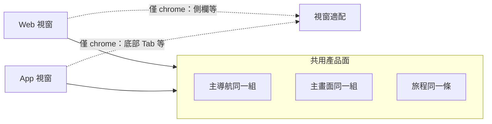
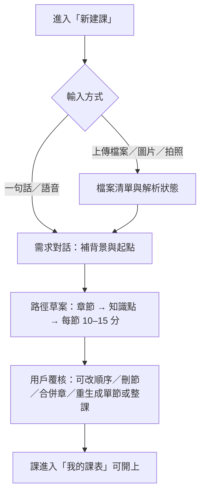
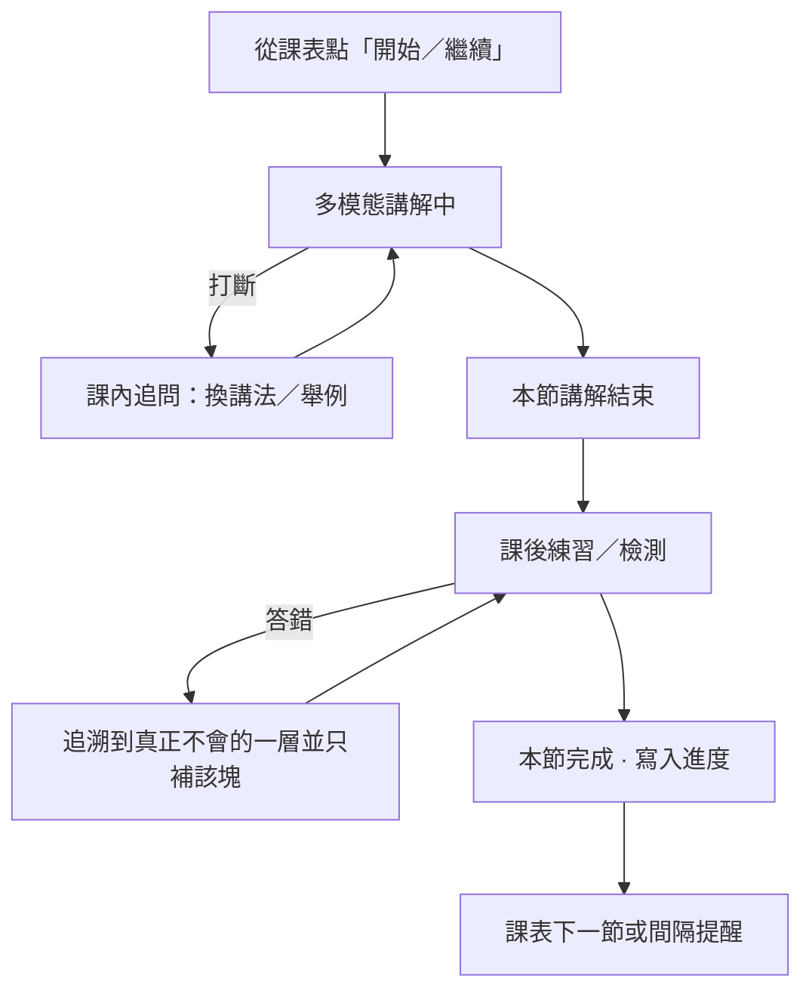
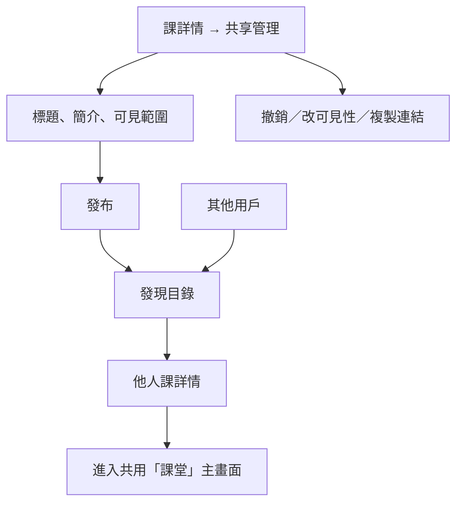
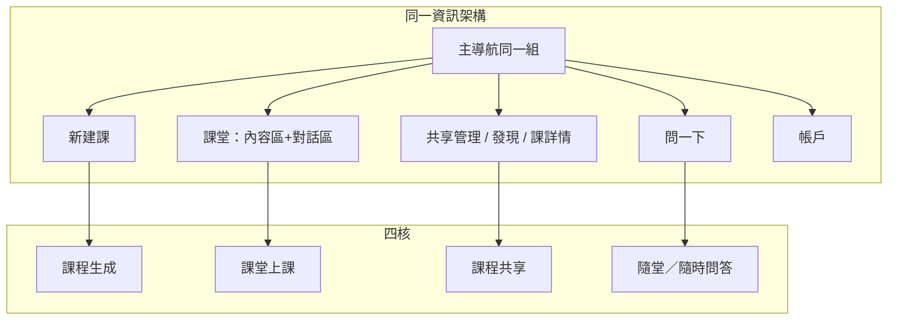

# Veridex 維學 — Web + App 呈現規格（Workstream C）

> **本文件是產品介面／資訊架構的唯一事實來源（SoT）：四核功能在 Web 與 App 上如何出現。**
>
> - 產品定位句：Veridex 是**課程學習應用程式**。
> - 四核（僅此四項）：**課程生成**／**課堂上課（多模態）**／**課程共享**／**就這一節的隨堂提問／隨時問正在學的內容**（能力＝隨時＋課中；對外標題用本措辭，勿以「AI 基本問答」作 headline）。
> - **鎖定（硬性）**：**功能與版面／資訊架構一致；僅視窗適配。** Web 與 App 是同一產品的兩個視窗——同一套主導航、同一組主畫面、同一條用戶旅程、同一組功能表面。允許的差別只有 chrome 的響應式適配（例如側欄導航 → 底部 Tab、雙欄在窄屏時改為可調整的分欄或折疊），**禁止**做成兩套不同產品布局（例如 Web 專用「左白板＋右對話」、App 專用「僅語音條＋板書卡」這種分叉 UI）。
> - 參照直覺：與 Grok Bot Web／App 同類——同一資訊架構與主流程，視窗變窄時改 chrome，不另發明一套 App 產品面。
> - 付款雙軌（Stripe 網頁優先、App Store 後補）見 `../economics/veridex-financial-model.md` §6.2；**本檔不重複訂閱費率論證**。帳戶能力兩端都有；結帳通路可走網頁實務偏好。
> - Deck P18「雙軌並行」講的是**社媒投放 + 內測招募**，與本檔的 Web／App 呈現無關。
> - 原型參考：`plans/prototype/veridex-prototype.html` 與課堂設計稿（內容區＋對話區）。現狀為設計稿，頁內數據為示例。**該構圖是兩端共用的課堂主畫面**，窄屏時折疊／縮放同一構圖，不換成另一套課堂 UI。

---

## 1. 既有 UI 主張盤點（寫 Spec 前已讀）

| 來源 | 已寫進對外敘事的介面／形態主張 | 本 Spec 如何承接 |
|---|---|---|
| `veridex-product-philosophy.md` §4.2–4.3 | 上傳或一句 prompt 生成課；語音教學 + 白板板書同步；可打斷追問 | 落成共用主畫面；兩端流程與版面結構相同 |
| 同上 §4.5 | 日曆連動、**手機通知**提醒間隔複習 | 提醒能力對等；App 系統推送／Web 瀏覽器或郵件為通道適配 |
| `veridex-pitch-product-spec.md` P3–P4 | 課程頁：章節／知識點／語音／板書同步；上課三條陳述 | 課堂主畫面兩端同一構圖（內容區＋對話區＋進度） |
| `veridex-pitch-part3-spec.md` 競品表 | Veridex **有手機 App**；Hyperknow 僅桌面站；Coursera 語音不支援 App | 兩端都能完整生成、上課、共享、隨堂／隨時問答，且看起來是同一產品 |
| `plans/html-content-source.md` Slide 3／6 | 四件事（備課／上課／檢驗／分享）；課堂頁＝白板＋要點進度＋右側對話 | 四核對齊（第四核對外標題見鎖）；課後檢驗掛在課堂旅程內，**不另立第五核**；課堂構圖兩端共用 |
| 口播校正稿 | 「AI 學習應用程式」；多模態＝文字／語音／圖片／動畫；用戶可共享自建課 | 共享的發布與開上在兩端同一套畫面與流程 |
| `veridex-financial-model.md` §6.2 | 網頁 Stripe 付費優先 | 帳戶頁兩端同一結構；**結帳**可優先深鏈網頁 Stripe（通路偏好） |

---

## 2. 一致鎖定：同一 IA、同一主畫面、僅視窗適配

**鎖定句（可進計劃書）**：**功能與版面／資訊架構一致；僅視窗適配。**

| 必須一致 | 允許適配（僅 chrome／密度） |
|---|---|
| 主導航項目與順序（課表｜發現｜問一下｜新建課｜帳戶） | 寬屏：側欄或頂欄；窄屏：**同一組項目**改為底部 Tab／摺疊選單 |
| 四核各自的主畫面名稱、區塊、主按鈕 | 字級、間距、欄寬隨視窗縮放 |
| 用戶旅程步驟順序 | 觸控／滑鼠的操作手勢 |
| 功能表面（每個核暴露的動作集合） | 雙欄在極窄屏時改為**同一兩區的可折疊分欄**（仍是那兩區，不是換成第三套 UI） |
| 帳戶、課卡、共享狀態、問答歷史的資料呈現欄位 | 推送通道（系統通知 vs 瀏覽器通知） |

**禁止**

- Web 一套產品布局、App 另一套產品布局（例如課堂在 Web 是左白板右對話，在 App 改成「只有語音條＋獨立板書卡流」而拿掉同構的對話區）。
- 「App 精簡版／Web 完整版」的版面敘事。
- 為窄屏發明新的主畫面名稱或新的主流程分支。

兩端共用：**同一帳戶、同一積分池、同一門課進度、同一共享狀態、同一問答歷史**。

### 2.1 四核 × 共用主畫面

| 四核 | 共用主畫面（兩端同一個） | 視窗適配（唯一允許的差別） |
|---|---|---|
| **課程生成** | 「新建課」：輸入區（上傳／拍照／語音／文字）＋需求對話＋路徑預覽＋結構編輯鈕＋確認生成 | 寬屏可並排輸入區與對話；窄屏改為上下堆疊**同一區塊**，按鈕集合不變 |
| **課堂上課（多模態）** | 「課堂」：頂欄（課名／知識點進度／工具）＋**內容區（白板：文字／圖／動畫）**＋**對話區（記錄＋輸入）**＋語音控制＋要點進度＋課後練習入口 | 寬屏：內容區｜對話區左右分欄；窄屏：同一兩區改為上下或可拖曳分欄／暫摺其中一區——**不刪區、不換成語音條專用 UI** |
| **課程共享** | 「共享管理」（可見性／連結／撤銷／簡介）＋「發現」目錄＋「他人課詳情」＋開始上課 | 目錄由網格改為同結構列表；管理項仍在課詳情同一組欄位 |
| **就這一節的隨堂提問／隨時問正在學的內容** | 「問一下」全域頁（隨時，選當前課／檔／不限）＋課堂內對話區（課中）——**兩入口＝隨時＋課中** | 導航入口隨 chrome 適配；頁內區塊不變 |
| **帳戶** | 「帳戶／我的」：方案、額度、設定、我的已發布課 | 結帳可深鏈 Web Stripe；頁面欄位仍一致 |



---

## 3. 四核 → 共用畫面與用戶旅程

每節旅程與主畫面 **Web／App 相同**。下列 wireframe 畫的是**同一畫面**在寬／窄視窗下的適配，不是兩套 UI。

### 3.1 課程生成

**用戶目標**：用講義／筆記／一句需求，得到可上課的章節路徑。

**旅程（兩端同一條）**



**共用主畫面「新建課」（寬屏／窄屏同一結構）**

```
寬屏適配                         窄屏適配（同一區塊堆疊）
┌────────────┬──────────────┐   ┌──────────────────┐
│ 輸入區      │ 需求對話      │   │ 輸入區            │
│ 上傳/圖/語音│ AI／你 …     │   │ 上傳/圖/語音/文字 │
├────────────┴──────────────┤   ├──────────────────┤
│ 路徑預覽（章節樹）          │   │ 需求對話          │
│ [改順序][刪節][重生成]      │   ├──────────────────┤
│              [確認生成]    │   │ 路徑預覽（同樹）  │
└───────────────────────────┘   │ [改順序][刪節]…   │
                                │     [確認生成]    │
                                └──────────────────┘
```

**實務運作**

- 生成完成後，課卡同時出現在兩端課表（同一張卡）。
- 路徑結構的全部編輯動作在兩端同一組按鈕上提供。
- 課後練習入口掛在課堂結束流（§3.2）。

---

### 3.2 課堂上課（多模態）

**用戶目標**：用 10–15 分鐘完成一節：聽講、看板書、必要時打斷，下課後立刻練。

**多模態通道（兩端同一課堂面全部具備）**：文字板書、語音、圖片／動畫、打斷追問、課後練習／追溯。

**共用主畫面「課堂」（對齊設計稿構圖 · 兩端同一）**

```
寬屏適配                              窄屏適配（同一兩區）
┌─ 課名 · 知識點 n/N · 工具 ────────┐  ┌─ 課名 · n/N · 工具 ─┐
│ ┌──────────────┐ ┌─ 對話記錄 ──┐ │  │ ┌─ 內容區（白板）─┐ │
│ │ 內容區（白板） │ │ AI …       │ │  │ │ 文／圖／動畫    │ │
│ │ 文／圖／動畫   │ │ 你 …       │ │  │ └───────────────┘ │
│ │ 要點進度       │ │ [輸入][送出]│ │  │ ┌─ 對話區 ──────┐ │
│ └──────────────┘ └────────────┘ │  │ │ 記錄＋輸入      │ │
│ [語音控制]           進度 10–15′ │  │ └───────────────┘ │
└─────────────────────────────────┘  │ 要點進度 · 語音控制 │
                                     └───────────────────┘
```

窄屏時兩區可上下排列或暫時摺疊其中一區以便閱讀，**摺疊後仍從同一入口展開，對話區與內容區都在**——禁止改成「僅語音條、無同構對話區」的另一套課堂。

**一節課完成態旅程（兩端同一條）**



積分規則歸經濟／定價 Spec；本檔規定**入口在課堂流內，且兩端同一入口位置與畫面**。

---

### 3.3 課程共享

**用戶目標**：發布自己的課給別人上；或發現並開上別人的課。積分仍按規則扣；著作權歸發布者。

**旅程（兩端同一條）**



**共用畫面**

| 畫面 | 區塊（兩端相同） | 視窗適配 |
|---|---|---|
| 共享管理 | 可見性、連結複製、撤銷、簡介編輯 | 側欄或整頁表單——欄位同一組 |
| 發現 | 搜尋／篩選＋課卡目錄＋章節預覽 | 網格⇄列表，卡內欄位不變 |
| 他人課詳情 | 作者、著作權、目錄、[開始上課] | 間距縮放 |

---

### 3.4 就這一節的隨堂提問／隨時問正在學的內容

**能力鎖**：隨時＋課中皆可問（不限「只在上課中」）。**對外標題**用本節標題；勿以「AI 基本問答」作計劃書主標題。

**用戶目標**：不開完整課堂也能問正在學的內容；在課內則帶該課上下文（隨堂提問）。

**兩個入口（兩端同一）＝隨時＋課中**

1. 課堂主畫面的**對話區**（§3.2）——**課中**。
2. 主導航 **「問一下」** 頁：上下文選擇（當前課／某個檔／不限）＋對話＋歷史——**隨時**。

```
主導航（項目與順序固定）
寬屏：側欄或頂欄 → 課表 | 發現 | 問一下 | 帳戶 ；主按鈕「新建課」
窄屏：底部 Tab → 課表 | 發現 | 問一下 | 我的 ；「新建課」為同權入口（FAB 或課表內主鈕）
```

需要板書時，「用這題開一節短講」進入課程生成或課堂短節（仍屬四核，**不把 Agent 寫成第五核**）。

---

## 4. 資訊架構（計劃書可用的最小 IA）

### 4.1 主導航（同一組 · chrome 適配）

| 導航項 | 寬屏 chrome | 窄屏 chrome | 打開的共用主畫面 |
|---|---|---|---|
| 課表 | 側欄／頂欄 | Tab | 課表；進課詳情／課堂／共享管理／新建課 |
| 發現 | 側欄／頂欄 | Tab | 發現目錄 |
| 問一下 | 側欄／頂欄 | Tab | 問一下 |
| 新建課 | 主按鈕 | 主按鈕／FAB | 新建課 |
| 帳戶／我的 | 側欄／頂欄 | Tab | 帳戶 |

### 4.2 視覺基調

| 項目 | 約定 |
|---|---|
| 背景 | 白／淺灰工作區 |
| 主文字 | 深墨藍（與簡報 Ink 同族） |
| 強調 | 少量琥珀／橙標籤（設計稿、進行中、共享中） |
| 課堂構圖 | **內容區＋對話區**為兩端共用骨架；僅分欄方向／摺疊隨視窗變 |
| 適配原則 | 縮放、折疊、側欄⇄Tab；**不替換主畫面、不刪功能區** |
| 狀態誠實 | 截圖標「設計稿」；示例數據不冒充實測 |

### 4.3 總覽



---

## 5. 與鄰近文件的邊界

| 主題 | 歸本檔 | 歸別處 |
|---|---|---|
| Web／App 功能＋版面／IA 一致、僅視窗適配 | ✓ | — |
| 共用主畫面與旅程 | ✓ | — |
| Stripe vs App Store 費率與毛利 | — | `economics/veridex-financial-model.md` §6.2 |
| 積分扣什麼、每天幾節課 | — | `economics/veridex-pricing.md` |
| 口播檢驗敘事 | 課堂旅程內承接 | pitch／書面計劃書正文 |
| Deck P18 社媒＋內測雙軌 | — | 運營／獲客 Spec 或計劃書運營段 |

---

## 6. 寫進計劃書時的可用短述（可直接摘）

**Web 與 App 一句**：**功能與介面一致；僅視窗適配。**（計劃書層只寫這一句，不細講布局。）Web 與 App 是同一套課程學習應用程式——同一主導航、同一組主畫面與四核流程（課程生成、多模態上課、課程共享、就這一節的隨堂提問／隨時問正在學的內容）；窄屏只改側欄⇄底部 Tab、分欄折疊等 chrome，不另做一套 App 布局。兩端共用帳戶、積分與課進度。

**四核上屏**：生成＝「新建課」；上課＝「課堂」（內容區＋對話區＋語音／圖／動畫）；共享＝共享管理＋發現＋開上；第四核＝「問一下」（隨時）＋課內對話區（課中）——兩端同一套畫面。
